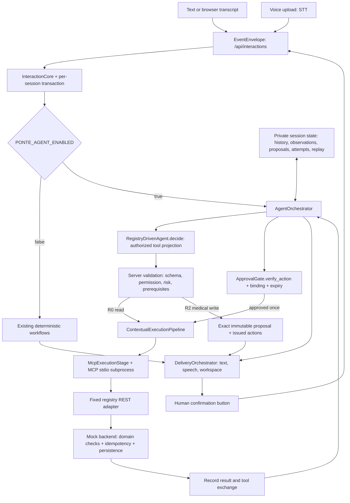

# Implemented agent execution

## Audit and integration

Before this change, `MiddlewareApplication` assembled `InteractionCore` with deterministic medical and cash-sharing workflows. `/api/interactions` and `CoreVoiceTurnProvider` already shared this core and `DeliveryOrchestrator`. The canonical contract was `EventEnvelope` -> `CanonicalInteractionResult` -> delivery metadata. The older message/action routes served compatibility and diagnostics.

`RegistryDrivenAgent` could select registry tools and iterate over read results within one call, but its local model history disappeared when it returned. R1/R2 proposals were returned without an integrated session/resume path. `ApprovalGate.resolve` used an isolated LLM classification to authorize execution. Neither component governed the canonical interaction route. `ContextualExecutionPipeline` already injected trusted context; `McpExecutionStage` already used the real serialized `McpStdioClient` transport and controlled REST adapter. `PendingToolProposal` already froze arguments, hashed their contents, and expired after five minutes. `SessionStore` protected its dictionary but did not serialize whole turns.

The new implementation reuses these components. It adds one orchestrator and private execution state to the existing route. No agent-demo endpoint was added. The existing independent agent/classifier APIs remain for compatibility; canonical agent execution uses `RegistryDrivenAgent.decide` and `ApprovalGate.verify_action`, never model classification as authorization.

## Runtime architecture



### History and resumability

Each session owns system/user/assistant/tool messages. Clients cannot provide authoritative history through `event` or `audit`. The model receives a copy of private history and authorized tool schemas; trusted HTTP headers are never projected into those schemas. Model-generated call IDs are replaced with server-owned step IDs. Tool responses are paired with their server call IDs and available to subsequent model decisions.

`InteractionTask` and existing task transition guards track idle, querying, awaiting input, awaiting confirmation, submitting, submitted, completed, and cancelled states. Read results and prior conversation remain available across user turns and approval pauses. Successful model responses complete the conversational task; a later utterance starts a new task while retaining session history. Task-local domain observations and attempted-write signatures reset for that new task. Clarifications, failures, and step limits pause the current task.

There are 12 decisions per turn and 64 per task by default. A turn limit can resume on another utterance. Session history, replay receipts, and traces currently have no eviction policy and grow with use; deployments need retention limits and durable storage before serving sustained real traffic.

Task-budget exhaustion marks the current task failed rather than leaving the session stuck. A subsequent utterance can start a fresh task while retaining prior session history and replay records. Any earlier completed receipt remains attached to the exhausted task. Rejecting a later proposal cancels only that pending operation; the response explicitly preserves earlier committed operations. Acknowledgments and server-generated recovery messages are recorded in history for later turns.

### Registered capabilities and trusted context

The default authorized set is fixed registry R0 GET tools plus `medical.create_appointment`. Applications may inject a smaller `agent_authorized_tools` allowlist. Unknown names, unimplemented writes, unsupported risks, unexpected input keys, incorrect primitive types, missing required fields, invalid enums, non-finite JSON values, and unsafe path identifiers are rejected before execution. The model cannot choose HTTP methods, backend hosts, arbitrary URLs, authorization headers, request IDs, idempotency keys, or patient identity. Model booking schemas omit patient ID and consent; the server constructs those exact fields for a pending proposal.

The MCP adapter still enforces context headers and maps every call to registry-owned methods and paths. Backend validation is also retained. This layered control is not a claim of complete prompt-injection resistance: hostile user or backend content can influence summaries and tool choices within the permitted read capability set. Tests verify that it cannot enlarge the capability set or authorize a write.

Both the chat HTTP transport and MCP REST adapter reject redirects, including redirects to another host. The shared `http_policy.py` opener prevents a configured endpoint from sending the execution or credentials to an unregistered destination. Environment proxies remain disabled. Both Python image definitions include this shared module, and Docker Compose forwards the default-off agent flag.

Provider-facing tool schemas and assistant tool-call history use fixed aliases such as `medical__list_departments`. The server maps them back to `medical.list_departments` for registry validation and MCP dispatch. This satisfies the [OpenAI function-name format](https://developers.openai.com/api/reference/resources/chat/subresources/completions/methods/create) while retaining canonical registry names in proposals and execution records. Alias construction rejects collisions or invalid names; the model cannot add alias mappings.

### Medical domain prerequisites

Booking requires a service from a successful server-observed service catalog and a slot from a successful slot search for that same service. Disabled services, unavailable slots, and zero capacity are rejected. Referral-required services need a patient appointment observed through authorized appointment reads. A model-provided referral ID alone is insufficient. The approved proposal contains the server patient ID and consent, the selected service and slot, and any allowed booking fields. The backend continues to validate identity, consent, slot membership/capacity, duplicates, and referral presence during commit.

Observed catalog/slot facts are revalidated at approval; they are not automatically refreshed. The backend remains authoritative for availability changes between search and commit. Mock referral validation proves existence of a patient appointment, not clinical appropriateness of a referral. Creating outpatient registrations and other registry writes remains unsupported in agent mode until equivalent validators exist.

### Explicit approval and replay

Every write creates a five-minute `PendingToolProposal`. The private proposal is bound to session ID, task ID, and server-owned identity/configuration. The canonical response contains exact reviewable arguments, tool name, risk, expiry, confirmation ID, and generated approve/reject/modify actions. Patient context is removed from public details.

The client submits the complete server-issued action as a `confirmation_decision`. The gate verifies exact event equality, proposal integrity, expiry, and confirmation ID. The orchestrator verifies session/task/context binding and rechecks current permissions and domain facts. Added arguments, changed action/task/confirmation IDs, cross-session replay, stale cancelled proposals, and expired proposals cannot commit. A narrow deterministic acknowledgment such as “yes” keeps the proposal visible and requests the button action; any changed request withdraws it and requires a revised turn. Reject cancels without dispatch; modify withdraws and waits for new input.

An approved proposal is consumed before dispatch. Its execution attempt is marked, its write signature remembered, and a stable `IDEMP-<proposal_id>` key sent through MCP. The returned result is recorded and appended to model history before resuming the loop. Backend appointment/receipt structure is verified before exposing a success receipt. Repeated interaction IDs return stored canonical results only if their event is unchanged. A consumed action may also replay with a new interaction ID and returns its stored result without model or tool execution. Replaying an old action returns its old result; it does not change the current task.

Successful approvals dispatch once within the process. Transport errors, backend failures, or invalid receipts may leave an uncertain external outcome. They are recorded and paused, never retried automatically. In-memory attempts cannot provide global exactly-once delivery or recover an uncertain commit after server restart. Backend idempotency helps only while the exact stored key can be reused by a future durable recovery implementation.

### Concurrency, delivery, and traces

`SessionStore.transaction` supplies a per-session reentrant lock held across core processing, model calls, approval verification, dispatch, result recording, and replay insertion. Different sessions have separate locks; the existing MCP client serializes its stdio transport. Locks are process-local. Legacy diagnostic/controller paths do not participate in this new canonical agent transaction.

Text and voice transcripts enter the same core; an utterance cannot bypass the explicit approval event. Delivery retains canonical task, response, workspace, confirmation, recovery, receipt, and speech metadata fields. `agent_response` supplies model text and a generic workspace containing exact proposal details and normal frontend action envelopes. Existing frontend components already render these fields and forward action events unchanged. TTS failure remains isolated from execution state.

Structured private traces record sequence, task ID, decision type, validated tool/risk, proposal ID, approval decision, execution start/result status, and resume/pause. They omit prompts, tool arguments, credentials, user content, backend payloads, and internal model reasoning. Terminal traces use the existing safe logger. The recorded decisions are observable model selections, not hidden chain-of-thought. Existing DEBUG MCP logging may contain medical mock data despite credential masking.

Known server authorization credentials, their bearer token, and the configured provider key are redacted from user/assistant history and backend result/request-ID echoes. Arguments containing those protected credentials fail validation instead of becoming a proposal. This targeted redaction is tested; it is not a general guarantee of removing every secret or sensitive value from arbitrary text.

## Configuration and verification

`PONTE_AGENT_ENABLED=false` is the default. Enabled mode uses `PONTE_LLM_API_URL`, `PONTE_LLM_API_KEY`, and `PONTE_LLM_MODEL`. Missing model configuration fails startup; malformed/provider responses pause with a fixed safe message and no fallback write. No API key is needed for scripted tests.

Local dependencies and capability policy are validated before the application starts the MCP child. If child startup fails, the application closes the client before propagating the startup error. If later voice-provider configuration fails, `create_application` closes the already-started application before propagating that error. Tests cover invalid policy with zero starts, failed startup cleanup, and post-start voice configuration failure.

```bash
python -m pytest -q
python -m unittest discover -s MCP/tests -v
python -m unittest discover -s middleware/tests -v
python -m unittest discover -s tests -v
python -m compileall -q MCP middleware mock_backends frontend scripts tests http_policy.py
```

`middleware/tests/test_agent_orchestrator.py` uses the actual canonical HTTP server and execution pipeline with scripted LLM and MCP fixtures. It covers multiple read tools and cross-turn history; approval/commit/resume; cancellation/modification; changed arguments and action IDs; cross-session and interaction replay; expiry; malformed/native decisions; provider and backend failure; failure after commit; permission revocation; hostile user/backend instructions; concurrent approval; voice transcript parity; and resumable turn limits.

`middleware/tests/test_agent_provider_http.py` exercises the actual `OpenAICompatibleChatClient` through a local scripted HTTP provider. It verifies native function responses, valid provider-facing names and message ordering, approval/resume, HTTP 503 and invalid JSON recovery, multiple-call rejection, and credential-echo handling. No paid provider credential is required.

`tests/test_agent_full_stack.py` starts a real persistent mock backend, establishes a patient referral, starts the actual MCP subprocess and middleware HTTP server, and performs catalog -> slots -> referral lookup -> proposal -> human action -> appointment commit -> lookup -> final model response. It runs with both an injected scripted client and the actual chat HTTP client against a local scripted native-function provider. It asserts backend booking count before/after and verifies replay creates no duplicate. Setting `PONTE_TEST_TRACE_PATH` saves the successful HTTP-provider runtime's sanitized trace, proposal, approval event, receipt, and backend count evidence.

The original regression suites are retained. Compatibility fixes restore workflow selection actions, use a UTC+8 fallback when Windows lacks timezone data, and align dated integration fixtures with fixed clocks. These tests exercise scripted runtime behavior against mock services; they do not establish live model reliability, production authentication/security, durable execution, distributed isolation, browser interaction automation, or real clinical validation.

`tests/test_transport_redirects.py` uses local redirect and target servers to verify neither outbound transport contacts the target. `tests/test_runtime_packaging.py` copies the Python runtime sources specified by both Dockerfiles into isolated directories and imports the server/transports there. This checks runtime dependency inclusion; it does not substitute for a complete container build and startup test.

Default mock slots roll with the current Macau date and omit elapsed slots. Explicit fixed clocks preserve the original August fixtures used by integration tests.

## Current verification — 13 October 2026

The canonical agent path now supports bounded Qwen final-response normalization. Qwen configuration opts in; generic clients remain strict. After a protocol parse failure, only an assistant message with explicit stop, absent/empty tool calls, and nonempty prose not beginning with { or [ is eligible. Exactly one additional completion receives a copied history, the prose, and a server-owned formatting instruction. It has no tools or tool choice. Only strict JSON respond/clarify with a message is accepted; native calls, operation/approval fields, repeated prose, incomplete output and malformed JSON fail closed. Repair messages never enter authoritative history. This is a text formatting step, not authorization or semantic proof of the answer.

The fresh Docker Linux Python 3.13.16 run passed **362 tests and 57 subtests**, with zero failures, errors or skips (65.730 seconds). The four retained Node frontend behavior tests passed. Python compilation and git diff whitespace checks passed. Compose and Render images rebuilt locally; no cloud deployment occurred.

Earlier live QwenCloud qwen3.7-plus evidence demonstrated catalog/slots/referral reads, explicit issued approval, booking commit, resume, and replay without a duplicate. That recorded run remains overall unsuccessful because its later read-only turn returned Markdown. The new repair is verified through scripted real provider HTTP and canonical /api/interactions, but has not been rerun against live Qwen. No paid provider calls were made during this continuation. The local demo remains deterministic at localhost:5173; paid agent mode is disabled pending provider capacity.

The frontend now includes a collapsed, localized accessible text entry that uses the same canonical interaction route and confirmation actions. Default mock slots roll with the Macau date over today and the next three days, skipping elapsed slots; fixed-clock August fixtures remain available to retained tests. Server-owned Macau date is refreshed each turn. Native functions are serialized; protocol-only ponte__respond/ponte__clarify finalizers cannot dispatch MCP operations. Qwen thinking is disabled and completion timeout defaults to 30 seconds.

Limits: history, locks, proposals, attempts and replay remain process-local without durable recovery or distributed exactly-once guarantees. Production authentication, session ownership, CSRF and IAM are not implemented. Referral observations establish an existing mock appointment, not clinical suitability. Only validated medical appointment creation is supported as an agent write. Browser speech fallback remains; no real cloud STT/TTS verification was performed. Summary correctness and universal injection resistance are not guaranteed. Persistent Compose volume was preserved; changes remain uncommitted and unpushed, with no PR.
